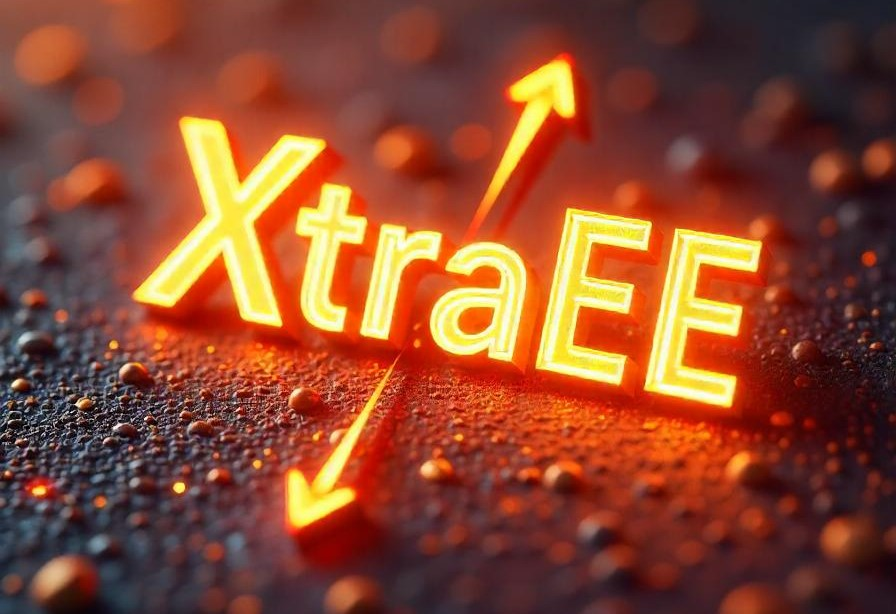

# XtraEE

XtraEE is a quantum chemistry tool designed to analyze excited-state calculations, providing a comprehensive comparison between different methods such as CCSD and CIS. It calculates transition amplitudes, accuracy, and provides insights into the similarity between excited states.


<div align="center">
  
</div>

Table of Contents
=================
<!--ts-->
* [What does this program do?](#what-does-this-program-do)
* [What is necessary to use it?](#what-is-necessary-to-use-it)
* [How to install it?](#how-to-install-it)
* [How to use it?](#how-to-use-it)
  * [Compare two states](#compare-two-states)
  * [Extract the data of a calculation](#extract-the-data-of-a-calculation)
  * [Compare all states](#compare-all-states)
  * [Excited-state descriptors](#excited-state-descriptors)
  * [Accuracy methods](#accuracy-methods)
  * [Running the tests](#running-the-tests)

<!--te-->
    
## What does this program do?

1. This package collects data from excited-state calculations:

| **From EOM-CCSD**                                | **From CIS**                                     |
| :----------------------------------------: | :----------------------------------------: |
|               State type (singlet or triplet)            |               State type (singlet or triplet)            |
|                     State number                               |                     State number                               |
|              Excitation energy                          |              Excitation energy                          |
|           Transition between orbitals                |           Transition between orbitals                |
|              Transition amplitude                       |              Transition amplitude                       |
|              Oscillator strength                        |              Oscillator strength                        |
|     $R_0^2$, $R_1^2$, and $R_2^2$ values       |                                            |
|               Omega or Mulliken value                    |                                            |

2. It matches the transitions between orbitals of the two states and utilizes the matched transition's amplitudes (denoted as $a_i$ for State 1 and $b_i$ for State 2) in the equation below to calculate an accuracy value, ranging between 0 and 1:

$$Accuracy = \sum_i{a_i b_i}$$

  A normalised version of the same overlap is available as `--acc-method cosine`; see
  [Accuracy methods](#accuracy-methods) for the difference.
  
3. It prints the relevant data into separate files for further analysis.

## What is necessary to use it?

The excited-state calculations must be performed using the **QChem** quantum chemistry software (EOM-CCSD, CC2, CIS, TDDFT, CISD, CIS(D) and ADC(2) outputs are recognised), or with **Turbomole** for CC2.

## How to install it?

```bash
git clone git@github.com:dpooria/xtraee
cd xtraee
pip install .
```

Python 3.10 or newer is required. For development, install the test dependencies as well:

```bash
pip install -e ".[dev]"
```

## How to use it?

Every command takes the calculation outputs as positional arguments. The parser is
picked from the file content, so there is no method flag to remember. The common
options are:

| Option | Meaning |
| :--- | :--- |
| `--outdir DIR` | where every output file is written (default: the current directory) |
| `--threshold X` | drop transitions whose \|amplitude\|² is below `X` (default: 0) |
| `--ref NAME` | parser used as the reference for the `vsstd` files (default: `EOM-CCSD`) |
| `--full` | also write the full per-state dump (`fulldata_<METHOD>.txt`) |
| `--debug` | print the parser's debug log to the terminal |
| `--version` | print the version and exit |

`xtraee <files>` without a sub-command runs `extract`; `python -m xtraee ...` works too.

### Compare two states

```bash
xtraee compare ccsd_output.log cis_output.log CCSD:singlet-1/A CIS:singlet-3/
```

- `method_name`: the method as it appears in the extracted data (`EOM-CCSD`/`CCSD`, `CC2`, `CIS`, `TDDFT`, `CISD`, `CIS_D_`, `ADC2`).
- `state_name`: the state type (`singlet` or `triplet`).
- `state_number`: the state numbering used in the `.log` file.
  * For `CCSD`, use the `state_number/A`
  * For `CIS`, use the `state_number/`

The command prints three values:

```log
Comparing singlet-1/A and singlet-3/

accuracy          | error             | fraction matched
0.9660054369      | 0.0339945631      | 1.0000
```

- **Accuracy:** how much the two states overlap (see [Accuracy methods](#accuracy-methods)).
- **Error:** the complement of the accuracy for the chosen method.
- **Fraction matched:** the fraction of transitions in State 1 that are matched to those in State 2, using State 1 as the reference.

The exit status is `0` on success and `1` when a state name cannot be parsed or the state
is not present in the file.

### Extract the data of a calculation

```bash
xtraee ccsd_output.log cis_output.log --outdir results --threshold 0.05 --full
```

writes, inside `results/`:

- **`data_<METHOD>.txt`:** every state of the calculation, sorted by excitation energy,
  with its matches in the other multiplicity (the "happy family").
- **`fulldata_<METHOD>.txt`:** the same states with all of their transitions (with `--full`).
- **`vsstd_<METHOD>.txt`:** the states of a non-reference file matched against the
  reference calculation (the "sad family"); written for every file whose method differs
  from `--ref`.

The file name prefixes come from `--out-data`, `--out-fdata` and `--out-vsstd`.

### Compare all states

```bash
xtraee compareall ccsd_output.log cis_output.log --outdir results --acc-method cosine
```

writes one CSV per pair of irreps, `<singlet-irrep>_<triplet-irrep>_<METHOD>_compare.csv`
(singlets as rows, triplets as columns, e.g. `A_A_EOM-CCSD_compare.csv`) plus one
cross-method matrix per multiplicity,
`<method>-<irrep>.<multi>_vs_<reference>-<irrep>.<multi>_compare.csv`
(e.g. `CIS-A.singlet_vs_EOM-CCSD-A.singlet_compare.csv`).

### Excited-state descriptors

```bash
xtraee descriptors ccsd_output.log --outdir results
```

writes `results/descriptors.csv`, one row per EOM-CCSD state: `R2`, `gamma`, `omega`,
`loc`, `phe`, the correlation coefficient, `n_u`, `n_u,nl`, the NO participation ratio,
the state identifier, `|r_e-r_h|` and the two frontier natural-orbital occupations.
`--descriptors-file` takes a bare file name (written inside `--outdir`, the default) or a
path of your own. Descriptors are only extracted from EOM-CCSD/CC2 outputs.

### Accuracy methods

| `--acc-method` | Score | Notes |
| :--- | :--- | :--- |
| `inner-prod` (default) | $\sum_i \lvert a_i\rvert \lvert b_i\rvert$ | the equation above. It is **not** normalised, so a state compared with itself scores $\sum_i a_i^2$ (below 1 whenever some amplitudes were not printed) |
| `cosine` | $\sum_i a_i b_i / (\lVert a\rVert\,\lVert b\rVert)$ | normalised overlap: identical states score exactly 1.0, so the number is comparable between methods whose printed amplitudes carry different total weight |
| `w-abs` | $1 - \sum_i p_i\lvert p_i-q_i\rvert / \sum_i p_i$ | probability-weighted mean absolute difference |
| `pearson` | correlation of the paired probabilities | insensitive to the overall scale, reports `0` instead of `nan` when there is nothing to correlate |
| `innerp-retrieve` | `inner-prod`, after reconstructing the unmatched amplitudes with a constrained least-squares fit | for states printed with fewer transitions than the reference |

### Running the tests

```bash
pip install -e ".[dev]"
pytest
```

The suite runs offline. The EOM-CCSD and CC2 example logs committed under
`tests/test_qccsd/` and `tests/test_tmcc2/` are used for the golden-file tests; the other
example logs are not part of the repository, so the tests that compare against them are
skipped unless you drop your own files next to them.
